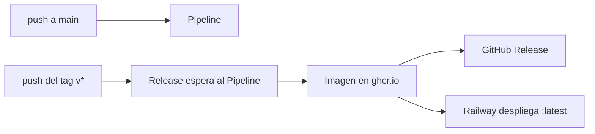

# Publicar una versión

Publicar **es** desplegar: un tag estable `vX.Y.Z` llega a producción sin aprobación manual.

## Pasos

1. Confirmar que `main` tiene el [Pipeline](https://github.com/QuispeBrianGabriel/crockgold_core/actions/workflows/pipeline.yml) en verde.
2. Si hay migraciones, comprobar que cumplen sus [reglas](DEVELOPMENT.md#migraciones). Si cambió la imagen, [probarla antes](DEVELOPMENT.md#probar-la-imagen-de-producción-antes-de-un-release).
3. Elegir el número siguiente según [SemVer](https://semver.org/lang/es/). `make version` muestra el último.
4. Publicar con `make release V=0.3.4`. Valida que estás en `main` sin cambios pendientes y pide confirmación.
5. Seguir el workflow [Release](https://github.com/QuispeBrianGabriel/crockgold_core/actions/workflows/release.yml) y el despliegue en Railway.
6. Comprobar producción con `make smoke URL=<url> USUARIO=<usuario> CLAVE=<clave>`.

El smoke espera `200` en `/actuator/health`, `401` sin credenciales y `404` con ellas. El `404` es lo esperado hoy, porque la API aún no expone endpoints de negocio.

Si producción falla: [RUNBOOK.md](RUNBOOK.md).

## Reglas

- La versión no se escribe en ningún archivo: sale del tag.
- Un tag publicado no se mueve ni se reutiliza. Si salió mal, se publica el siguiente número.
- Un prelanzamiento (`v0.4.0-rc.1`) publica su imagen sin mover `latest`, así que Railway no despliega. Sirve para probar la imagen exacta.
- Las notas del Release salen de los commits. Sin Conventional Commits quedan incompletas y nada lo valida.

## Fallos del workflow Release

| Job que falla | Causa probable | Qué hacer |
| ------------- | -------------- | --------- |
| «Wait for pipeline», en segundos | El Pipeline del commit aún no existía, o el commit nunca se envió a una rama | Confirmar que el Pipeline existe y usar **Re-run failed jobs** |
| «Wait for pipeline», tras esperar | El Pipeline del commit falló | Si fue pasajero, relanzar el Pipeline y luego el Release. Si es real, corregir en `main` y publicar el siguiente número |
| «Publish image» | `Dockerfile.prod` no construye, o falló el registro | [Reproducir en local](DEVELOPMENT.md#probar-la-imagen-de-producción-antes-de-un-release). Relanzar si fue pasajero |
| «Create GitHub release» | El Release ya existe o falló la API | La imagen **ya está publicada y desplegándose**. Relanzar solo ese job o crear el Release a mano |

Si el workflow falla, el tag ya es público. No se borra: se corrige y se publica el siguiente número.
